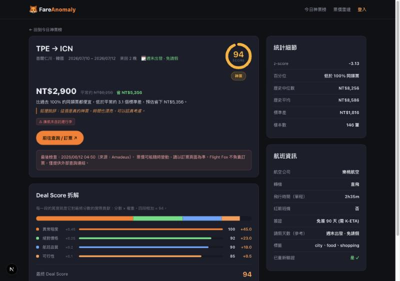

# 期末專案發想 — FareAnomaly 機票異常便宜雷達

> 繳交標題（請自行填學號/系級/姓名）：
> `學號 系級 姓名 期末專案發想 — FareAnomaly 機票異常便宜雷達`

---

## 一、一句話描述

**FareAnomaly** 是一個每天自動掃描台灣出發機票市場的網站，用統計方法找出「相對於自己過去價格、便宜到不合理」的來回機票，並以 **Deal Score** 排名呈現，使用者還能設定「票價雷達」在到價時收到通知。

核心主張：**不要問去哪裡，先看哪裡便宜到不合理。**

一般比價網回答「A 到 B 現在多少錢」；FareAnomaly 回答一個不一樣的問題——**「現在有哪條線，便宜到值得為它排假出發？」**

---

## 二、為什麼做這個（問題）

- 機票比價工具很多，但它們都假設「你已經決定要去哪」。真正的好康常常是反過來的：**某條線突然跳水**，這時候才決定要不要去。
- 「便宜」是相對的。NT$9,000 飛東京可能很普通，但飛倫敦就是神票。單看絕對價格沒意義，**要跟這條路線自己的歷史比**。
- 所以這題本質是一個 **異常偵測（anomaly detection）** 問題，而不是比價問題。

---

## 三、核心概念：什麼叫「異常便宜」

對每一條路線，持續累積它的歷史票價，算出平均與標準差，再用 **z-score** 衡量今天這張票偏離常態多少：

```
z-score = (今天票價 − 歷史平均) ÷ 歷史標準差
```

- z 越負 → 越偏離常態 → 越異常便宜。
- 轉成白話標籤：`神票 (z<-2)` / `很便宜 (z<-1.5)` / `可考慮 (z<-1)` / `普通`。
- 再換算百分位：「比過去 96% 的同艙票便宜」。

> 概念圖見 `02-anomaly-concept.svg`。

---

## 四、Deal Score：一張票值不值得衝

只看「異常」不夠——異常但很貴、要轉三次機、紅眼、還要請五天假，也衝不下去。所以用一個加權分數綜合判斷：

```
Deal Score = 0.45·異常程度 + 0.25·絕對價格 + 0.20·航班品質 + 0.10·可行性
```

| 因子 | 權重 | 看什麼 |
| --- | --- | --- |
| 異常程度 | 0.45 | z-score 偏離歷史常態多少（雷達核心） |
| 絕對價格 | 0.25 | 實際金額校正，太貴就算異常也扣分 |
| 航班品質 | 0.20 | 轉機、紅眼、廉航無行李、偏遠機場、價格過期 → 扣分 |
| 可行性 | 0.10 | 免簽、週末出發免請假（請假天數作參考） |

Phase 0 採 **規則式（rule-based）**，不需訓練模型，確保結果可解釋、可驗證。
> 拆解圖見 `03-dealscore.svg`。

---

## 五、系統流程（技術架構）

> 流程圖見 `01-architecture.svg`。

```
①資料源 → ②每日排程抓取 → ③歷史快照累積 → ④異常偵測評分 → ⑤網站呈現＋通知
```

1. **資料源**：`TalorData`（即時爬 Google Flights）為主，`Travelpayouts` 為本機補充，抓 TPE/TSA/KHH 出發的來回票。
2. **每日排程**：`GitHub Actions` cron 每天台灣時間 09:00 自動執行抓取腳本，把當日票價存成快照並 commit 回 repo。
3. **歷史快照**：`data/snapshots/YYYY-MM-DD.json` 逐日累積，形成每條路線的時間序列，這就是 z-score 的基準來源。
4. **異常偵測**：對每條路線算 z-score、百分位、Deal Score、估計省下金額。
5. **呈現**：`Next.js` 網站 —— 今日神票榜（即時篩選）、Deal 詳情（分數拆解＋統計）、票價雷達（設定路線＋到價用 LINE/Email 通知）。

**使用技術**

| 層 | 技術 |
| --- | --- |
| 前端／全端 | Next.js 15 + React 19 + TypeScript |
| 評分邏輯 | 純函式（z-score、常態分布 CDF 百分位、加權 Deal Score） |
| 資料抓取 | Node.js 腳本 + 票價 API（TalorData / Travelpayouts） |
| 排程／儲存 | GitHub Actions（cron）+ repo 內 JSON 快照（Phase 1；Phase 3 改 DB） |
| 通知 | LINE / Telegram / Email（Phase 3） |

---

## 六、目前進度（已開始動工，可行性已驗證）

作業要求「確定可行、部份先手動沒問題但能正確完成」——這部分我已經實作並驗證：

- ✅ **Phase 0 假資料 dashboard 已完成且可互動**：今日神票榜排名、Deal Score 圓形儀表＋加權拆解、統計細節（z-score／百分位／歷史中位數）、即時篩選、票價雷達設定頁、狐狸銳評。（截圖見下）
- ✅ **Phase 1 每日抓取已實跑成功**：抓取腳本 + GitHub Actions 排程已在雲端成功執行，`TalorData` 對 12 條路線 ×（30/60 天期）= **24/24 全命中**（含長途倫敦／洛杉磯），並已把快照 commit 回 repo。
- ✅ **資料源實測與可靠度驗證**：實測發現 TalorData 是即時爬蟲、會間歇性失敗，因此在抓取腳本加入**成熟的重試機制**（暫時性失敗自動重試、認證／參數錯誤立即停不空轉），並用真實回傳 JSON 校正解析（欄位名、字串價格轉數字）。

**接下來要補的（期末完成目標）**

1. TalorData 價格回成 USD → 換匯成 TWD。
2. 累積足夠天數的快照後，接上真實 z-score 基準（目前基準為假資料）。
3. 把 dashboard 從讀假資料改成讀真實快照，打通「抓取 → 評分 → 呈現」全鏈路。
4. 串接至少一個真實通知管道（LINE 或 Email）。

---

## 七、Demo 截圖

**今日神票榜（排名 + Deal Score）**


**Deal 詳情（分數拆解 + 統計細節）**


---

## 八、期末展示預計呈現

- 一個可操作的網站：打開就能看到「今日台灣出發的異常便宜票」排名。
- 每張票點進去，能看到它為什麼被判為神票（z-score、百分位、省多少、扣分原因）。
- 後台每天自動更新（GitHub Actions 排程），資料是真實抓來並逐日累積的。
- （加分）設定一條票價雷達，到價時收到通知。
